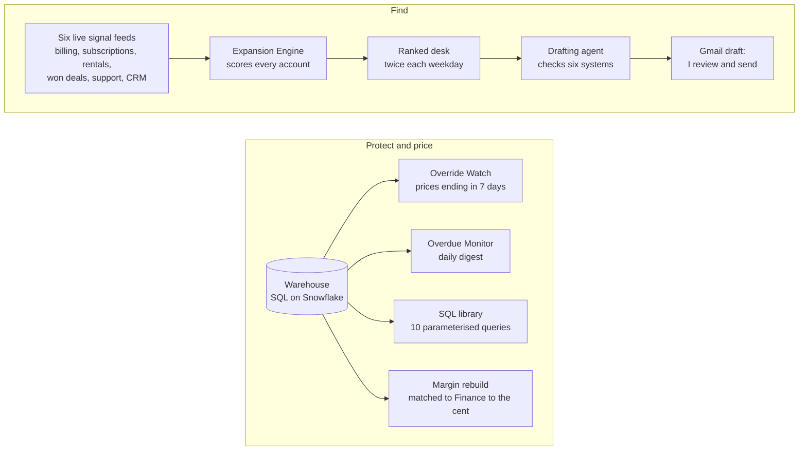

# Machines

System design notes for the machines I build, at Apify and on my own. I wrote every page fresh for this repo, and there's no company code in it. The code for the work machines lives in company repos, so each page here describes its machine: the problem, who uses it, how it works, a diagram, the key decisions, the guards and what changed. Every machine also has a page with a working diagram on [kayabraham.com](https://kayabraham.com).

| Machine | Job | Status | What it does | Page |
|---|---|---|---|---|
| [Expansion Engine](engine/) | Find | Running | Reads six live signal feeds, scores every account and hands each Product Advocate a ranked desk twice each weekday. | [kayabraham.com/machines/engine](https://kayabraham.com/machines/engine/) |
| [Override Watch](override-watch/) | Protect | Running | Tells the account manager seven days before a custom price expires, so they talk to the customer before the bill does. | [kayabraham.com/machines/override-watch](https://kayabraham.com/machines/override-watch/) |
| [Overdue Monitor](overdue-monitor/) | Protect | Running | Sends each account manager a daily digest of their overdue invoices, before finance has to escalate. | [kayabraham.com/machines/overdue-monitor](https://kayabraham.com/machines/overdue-monitor/) |
| [Margin rebuild](margin/) | Price | Done | Rebuilds Finance's gross margin report from the raw warehouse tables and matches it to the cent. | [kayabraham.com/machines/margin](https://kayabraham.com/machines/margin/) |
| [SQL library](sql-library/) | Price | Running | Ten shared queries any Product Advocate runs with parameters, so pricing and usage questions take minutes. | [kayabraham.com/machines/sql-library](https://kayabraham.com/machines/sql-library/) |
| [News Intelligence Agent](news-agent/) | Ship | Running | Turns a plain news question into a cited brief. Public on the Apify Store, pay per event. | [kayabraham.com/machines/news-agent](https://kayabraham.com/machines/news-agent/) |
| [Drafting agent](drafting-agent/) | Agents | Running | Drafts customer emails in my voice from my ranked desk. I review and send each one myself. | [kayabraham.com/machines/drafting-agent](https://kayabraham.com/machines/drafting-agent/) |

## How they fit together

The machines share two inputs: live account signals and the data warehouse. The Engine turns the signals into one ranked desk per Product Advocate; the drafting agent works from that desk; the monitors and the SQL library read the warehouse. Every customer decision stays with a person.

## The five jobs

Each machine does one of five jobs: **Find** revenue, **Protect** revenue, **Price** revenue, **Ship** products, and **Agents** that work for me.

## Also in this repo

- [PLANNING.md](PLANNING.md): how I plan a machine.
- [ROADMAP.md](ROADMAP.md): what's planned next.

The News Intelligence Agent has its own design notes in [kay-abraham/news-intelligence-agent](https://github.com/kay-abraham/news-intelligence-agent).
