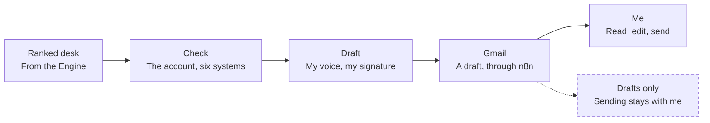

# Drafting agent

Reads my desk twice a day, checks six systems before it writes, and drafts customer emails in my voice with my signature. I review and send each one myself.

| Job | Status | Built with | Page |
|---|---|---|---|
| Agents | Live | Claude routines, n8n, Gmail | [kayabraham.com/machines/drafting-agent](https://kayabraham.com/machines/drafting-agent/) |

## Problem

The desk said who to write to, and the writing still took the afternoon.

## Who uses it

I do. It reads my ranked desk from the [Expansion Engine](../engine/) and leaves drafts in my Gmail for me to review and send.

## How it works

A Claude routine runs on weekdays, twice a day. It reads my ranked desk, checks the account across six systems before it writes a word, and drafts the email in my voice with my real signature. An n8n workflow puts the draft into Gmail. It writes up to five drafts each weekday. Then I read each one, edit it and send it.

## Architecture

Dashed lines and dashed boxes are guards.

## Key decisions

| Decision | Why |
|---|---|
| Write drafts only, and keep sending with me. | The tools inform and I decide what reaches a customer. |
| Deliver through an n8n workflow into Gmail. | The draft waits in Gmail with my real signature on it. |
| Learn my voice from 311 of my own email threads. | Each draft comes out in my voice. |

## Failure modes and guards

| What can go wrong | Guard |
|---|---|
| A wrong email reaches a customer. | The agent writes drafts only. I read, edit and send every one. |
| A draft misses what's happening on the account. | It checks the account in six systems before it writes a word. |

## Results

- Drafts wait in Gmail with my signature on them, and I send them.

## History

- **October 1, 2026.** Running since then.

---

The prompt and the voice data stay private. This page describes the design and the rules the agent runs by.
