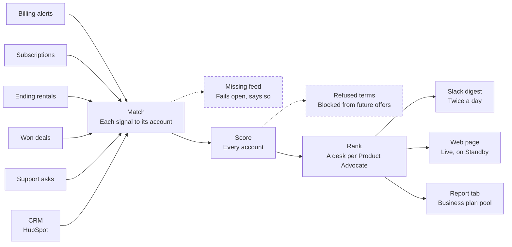

# Expansion Engine

Reads six live signal feeds, scores every account and hands each Product Advocate a ranked desk twice a day.

| Job | Status | Built with | Page |
|---|---|---|---|
| Find | Live | Python, Apify, Slack, HubSpot, Snowflake | [kayabraham.com/machines/engine](https://kayabraham.com/machines/engine/) |

## Problem

Three misses led here:

- Accounts grew quietly and no alarm went off.
- A customer left after an offer repeated terms they'd already refused.
- A CRM source went missing for two months and no alert fired.

## Who uses it

Seven Product Advocates at Apify, me included. Each one gets a desk of their own accounts twice each weekday. The report tab serves the wider company: it started as a colleague's request and was built for the company all-hands.

## How it works

The Engine is an Apify Actor written in Python. Six feeds come in: billing alerts, subscriptions, ending rentals, won deals, support asks and the CRM. It matches each signal to its account, scores every account and ranks each Product Advocate's accounts into a desk. Twice each weekday the desk goes out three ways: a Slack digest, a web page and a report tab on the Business plan pool. The Actor runs in Standby mode, so the desk is a live web page.

## Architecture

Dashed lines and dashed boxes are guards.

## Key decisions

| Decision | Why |
|---|---|
| Run as an Apify Actor in Standby mode. | The desk becomes a live web page. |
| Tag every account with its owner. | One instance serves the whole team, with a desk for each Product Advocate. |
| Keep state between runs in a named store. | A crash can't double-post or drop a window. |
| Block terms a customer refused from future offers. | A customer left after an offer repeated terms they'd already refused. |
| Let a missing feed fail open and say so on the desk. | A CRM source went missing for two months and no alert fired. |

## Failure modes and guards

| What can go wrong | Guard |
|---|---|
| A feed goes missing. | The Engine fails open: the desk still builds, and it says which feed is missing. |
| An offer repeats terms the customer refused. | Refused terms are blocked from future offers. |
| A run crashes halfway. | State lives in a named store, so a crash can't double-post or drop a window. |
| The desk suggests an account that's already in a live deal or had contact in the last week. | The Engine holds that account back and gives one play per account. |
| A code change breaks the Engine. | 786 tests run every night in GitHub Actions. |

## Results

- Quietly growing accounts now show up on the desk.
- Refused terms are blocked from future offers.
- Every missing source announces itself on the desk.

## History

- **July 2026.** The Engine starts running.
- **October 2, 2026.** Desks go out for 7 Product Advocates, and the report tab goes live.
- **October 2026.** 786 tests, run every night in GitHub Actions.

## What's next

A redacted showcase of the Engine is planned. See [ROADMAP.md](../ROADMAP.md).

---

The Engine's code and data stay in a company repo. I wrote this page for this repo to describe the design. The desk on [kayabraham.com](https://kayabraham.com) runs on made-up accounts.
