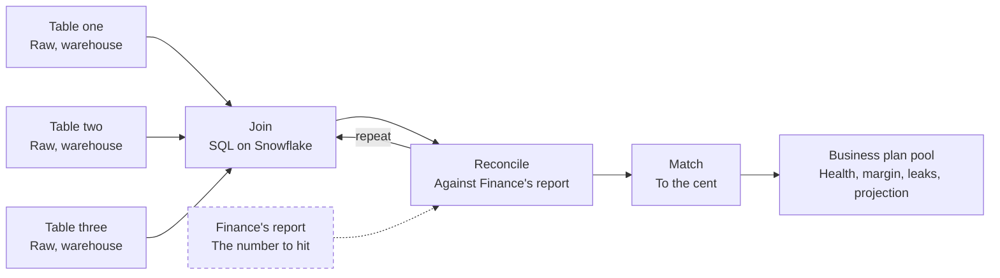

# Margin rebuild

I rebuilt Finance's gross margin report from the raw warehouse tables and matched it to the cent. The same method then fed a company report on the Business plan pool.

| Job | Status | Built with | Page |
|---|---|---|---|
| Price | Shipped | SQL on Snowflake | [kayabraham.com/machines/margin](https://kayabraham.com/machines/margin/) |

## Problem

The team's numbers didn't match Finance's.

## Who uses it

My team and Finance, who now work from one set of numbers. The Business plan pool report is a company report. It started as a colleague's request, was built for the company all-hands and lives as the report tab on the [Expansion Engine](../engine/).

## How it works

It's SQL on Snowflake. I joined three raw warehouse tables and reconciled the result against Finance's gross margin report, repeating the join and the check until the two matched to the cent. Then the same method fed a company report on the Business plan pool: health, margin, leaks and projection, on one page.

## Architecture

Dashed lines and dashed boxes are guards. Finance's own report is the guard here: the rebuild keeps going round the "repeat" loop until it matches.

## Key decisions

| Decision | Why |
|---|---|
| Start from the three raw warehouse tables. | The team's numbers didn't match Finance's. |
| Reconcile against Finance's own report until every month reads a difference of 0.00. | The team and Finance work from one set of numbers. |
| Reuse the method for the Business plan pool report. | The method already matched Finance to the cent. |

## Failure modes and guards

| What can go wrong | Guard |
|---|---|
| The rebuilt margin drifts from Finance's number. | Reconcile against Finance's report and repeat until every month reads a difference of 0.00. |

## Results

- One set of numbers for the team and Finance.
- A company report on the Business plan pool: health, margin, leaks and projection.

## History

- **October 2, 2026.** Done.

---

This page describes the method, and the numbers stay inside the company.
