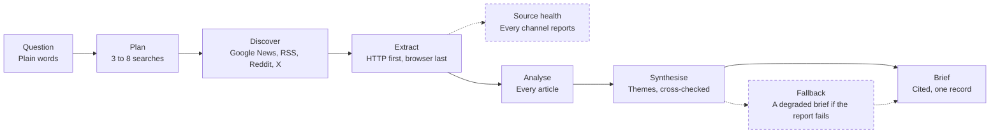

# News Intelligence Agent

A six-stage Claude pipeline that turns a plain question into a cited brief, priced per event.

| Job | Status | Built with | Page |
|---|---|---|---|
| Ship | Live | Node.js, Claude, Apify | [kayabraham.com/machines/news-agent](https://kayabraham.com/machines/news-agent/) and [the Apify Store](https://apify.com/kay_abraham/news-intelligence-agent) |

## Problem

A person or an AI agent asks a news question in plain words and needs a brief with its sources.

## Who uses it

Anyone can run it on the Apify Store. I built it for policy teams tracking global events, analysts who need a digest before a meeting, PR and brand teams watching coverage, investor research, journalists tracking patterns across sources, and agents or pipelines that need fresh news text.

## How it works

It's a Node.js Actor on Apify. A question goes through six stages: plan, discover, extract, analyse, synthesise and deliver. Claude plans 3 to 8 searches. The Actor finds articles on Google News, publisher RSS feeds, Reddit and X, and pulls the full text. Claude reads every article, cross-checks the themes and writes a cited brief. The Store meters it, pay per event.

## Architecture

Dashed lines and dashed boxes are guards.

## Key decisions

| Decision | Why |
|---|---|
| Report every source's health in every record. | A missing or failing source has to announce itself. `allSourcesAnswered` is the one flag to alert on. |
| Deliver a degraded brief if the final report fails twice. | The run still returns a brief, marked `degraded: true`, with the reason. |
| Run with limited permissions. | An AI agent or MCP client can call it without an approval step. |
| Rank sources a crawler can read first, and cap paywalled publishers at a fifth of the queue. | A run rests on URLs that return text. |
| Run the model through Apify, with zero keys to paste. | It works from an AI agent, an MCP client, a schedule, a webhook pipeline or a browser tab. |

## Failure modes and guards

| What can go wrong | Guard |
|---|---|
| A source or extractor fails. | `sourceHealth` lists each channel and extractor with its status and counts, and `warnings` holds whatever didn't answer. |
| A child call hits a transient failure. | One honest retry. A permission error gets zero retries. |
| The final report fails twice. | A degraded brief built from the per-article analysis. |
| Coverage comes back short. | A top-up wave extracts reserve candidates, with a headless browser as the last resort. |
| A run grows too big or too costly. | Max articles, a model spend cap and a run timeout bound every run. |

## Results

- A cited brief for a question, priced per event.
- The one machine here anyone can run.

## History

- **0.3.** Pay-per-event pricing, source tiers, quote extraction and anomaly detection.
- **0.4, October 2026.** Runs with zero API keys through Apify's model proxy, with limited permissions and a new articles-only mode.
- **0.4.15, October 2026.** Claude 5.5 models.
- **0.4.18, October 2026.** The reliability pass: source health in every record, one retry per child call and the degraded brief.

Full design notes live in [kay-abraham/news-intelligence-agent](https://github.com/kay-abraham/news-intelligence-agent).

---

The source is private. This page draws on the Actor's public README on the Apify Store.
