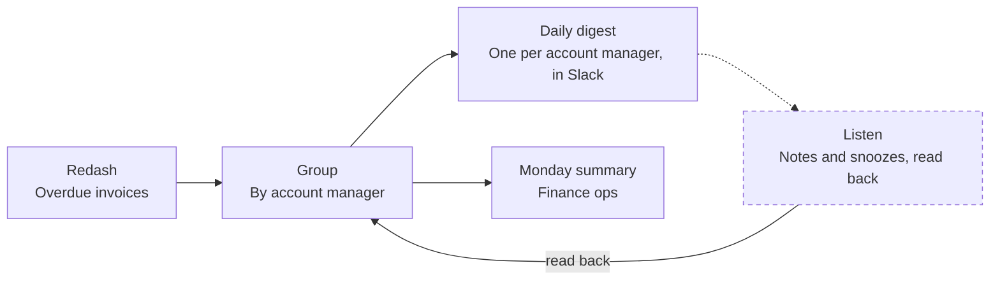

# Overdue Monitor

Overdue invoices reach the right account manager in a daily digest, before finance has to escalate.

| Job | Status | Built with | Page |
|---|---|---|---|
| Protect | Live | n8n, Redash, Slack | [kayabraham.com/machines/overdue-monitor](https://kayabraham.com/machines/overdue-monitor/) |

## Problem

Invoices sat twenty-plus days overdue and nobody acted until finance escalated.

## Who uses it

Account managers get a daily digest of their own overdue invoices. Finance ops gets a summary every Monday. RevOps co-owns the workflow with me.

## How it works

It's an n8n workflow on Redash and Slack. Every day it reads the overdue invoices, groups them by account manager and posts each one a digest in Slack. People leave notes and snoozes in the channel, and the workflow reads them back, so a snoozed invoice stays out of the digest. Every Monday, finance ops gets a summary.

## Architecture

Dashed lines and dashed boxes are guards. The "read back" link is the loop from the channel to the next digest.

## Key decisions

| Decision | Why |
|---|---|
| Post a digest every day. | Invoices sat twenty-plus days overdue before anyone acted. |
| Send one digest per account manager. | Each overdue invoice reaches the right account manager before finance has to escalate. |
| Read notes and snoozes back from the channel. | A snoozed invoice stays out of the digest. |

## Failure modes and guards

| What can go wrong | Guard |
|---|---|
| The warehouse query fails. | The workflow retries it. |
| A long digest runs past Slack's limits. | Each digest stays inside Slack's block and character limits. |
| A snoozed invoice keeps showing up. | Snoozes are read back from the channel, so a snoozed invoice stays out of the digest. |
| A note left in the channel goes unread. | The workflow reads the free-text notes people leave in the channel. |

## Results

- Each account manager gets a daily digest of their overdue invoices.
- Finance ops gets a Monday summary.

## History

- **July 2026.** Running since then.
- **October 2026.** On version 5.1.1. The code lives in Apify's GitHub, co-owned with RevOps.

---

The code lives in a company repo. I wrote this page for this repo to describe the design.
