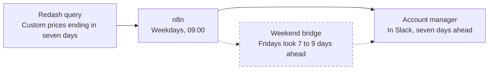

# Override Watch

The account manager hears seven days before a custom price expires and talks to the customer before the bill does.

| Job | Status | Built with | Page |
|---|---|---|---|
| Protect | Running | n8n, Redash, Slack | [kayabraham.com/machines/override-watch](https://kayabraham.com/machines/override-watch/) |

## Problem

Custom prices expired quietly and the customer got a bill shock.

## Who uses it

Account managers get a Slack message for every custom price on their accounts that ends in seven days. RevOps co-owns the workflow with me.

## How it works

An n8n workflow runs every weekday at 09:00. A Redash query finds every custom price that ends in seven days, and n8n posts each one to its account manager in Slack. On Fridays the window stretches from seven days to nine, so a price that ends over the weekend still gets its warning.

## Architecture

Dashed lines and dashed boxes are guards.

## Key decisions

| Decision | Why |
|---|---|
| Warn seven days ahead. | The account manager talks to the customer before the bill does. |
| Stretch the Friday window to nine days. | A price that ends over the weekend still gets its warning. |
| Let the query do the finding and n8n do the posting. | n8n runs the query on schedule and posts each price to the right account manager. |

## Failure modes and guards

| What can go wrong | Guard |
|---|---|
| A custom price ends on a Saturday or Sunday, seven days after a day the workflow doesn't run. | On Fridays the window covers seven to nine days ahead. |

## Results

- The account manager hears seven days ahead and talks to the customer first.

## History

- **February 2026.** Running since then. It's the oldest machine in this repo.
- Co-owned with RevOps.

---

The code lives in a company repo. I wrote this page for this repo to describe the design.
