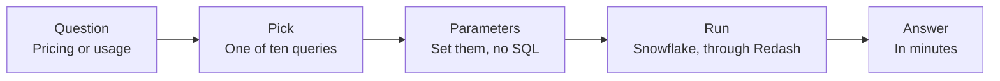

# SQL library

Shared queries any Product Advocate runs with parameters, so pricing and usage questions get answered in minutes.

| Job | Status | Built with | Page |
|---|---|---|---|
| Price | Live | SQL, Redash | [kayabraham.com/machines/sql-library](https://kayabraham.com/machines/sql-library/) |

## Problem

Every pricing or usage question became a data request, and a wait.

## Who uses it

Any Product Advocate picks a query, sets the parameters and reads the answer, without writing SQL.

## How it works

It's a library of ten shared, parameterised SQL queries on Snowflake, run through Redash. A Product Advocate brings a pricing or usage question, picks the query that answers it, sets the parameters and runs it. The answer comes back in minutes.

## Architecture

## Key decisions

| Decision | Why |
|---|---|
| Share the queries in one library. | Every pricing or usage question used to become a data request, and a wait. |
| Parameterise every query. | Any Product Advocate can run one by setting the parameters, without writing SQL. |
| Cover pricing and usage questions. | Those were the questions that turned into data requests. |

## Failure modes and guards

The guard is the parameters. A Product Advocate sets them and runs the shared query, so every answer comes from the same SQL.

## Results

- Pricing and usage questions take minutes.

## History

- **September 30, 2026.** In use since then.

---

Company data sits behind it, so this page describes the design.
